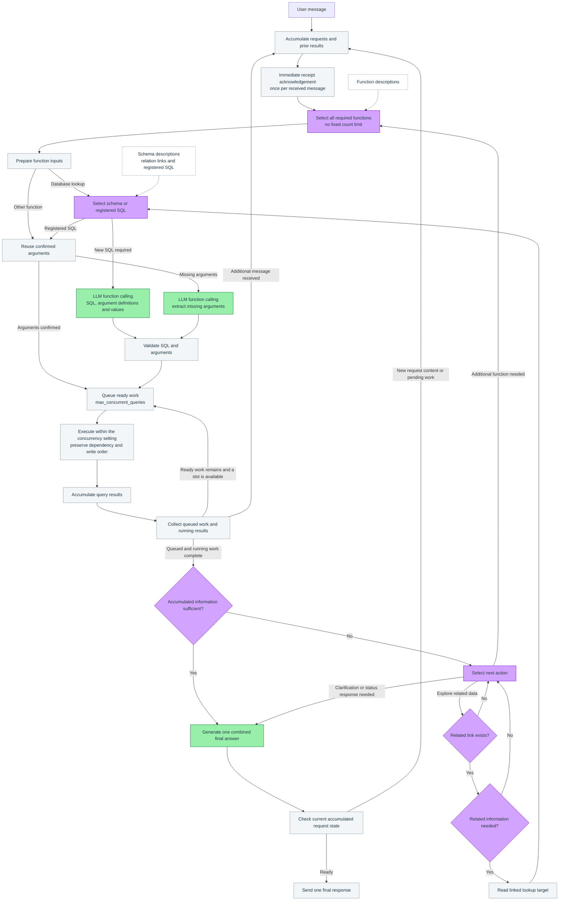

# Infinite Agent

Proposed architecture for a general-purpose agent with function calling and relational database retrieval.

- **Jev (purple):** function and schema selection, information sufficiency, and relationship decisions.
- **LLM (green):** missing argument extraction, new SQL generation, and final answer generation.
- **Code (gray):** immediate acknowledgements, concurrency control, queues, validation, and accumulated request state.

Additional messages and query results accumulate in the same active request. Required functions are selected without a count limit; only simultaneous queries are controlled by `max_concurrent_queries`. The accumulated request receives one combined final response.
