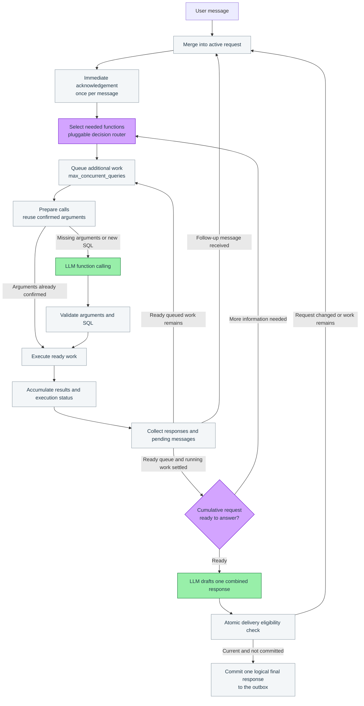

# Architecture

Infinite Agent keeps an active request open while information is being retrieved. Each message receives an immediate acknowledgement. Follow-up requirements and query results accumulate under the same request ID until a combined response is committed.

## Control flow

Receipt acknowledgements are separate from the final response. Re-entering the flow for an already recorded message must preserve its acknowledgement record and avoid appending the message twice.

## Responsibilities

| Component | Responsibility |
| --- | --- |
| Function registry | Describe each function, its argument schema, dependencies, authorization requirements, and execution behavior. |
| Decision router | Select needed functions and schemas, judge information sufficiency, and decide whether a relation link is relevant. Jev can be supplied through an adapter. |
| LLM function-calling adapter | Extract missing arguments; generate new SQL, parameter definitions, and values together when a registered query does not suffice. |
| Schema and query registry | Store table descriptions, relation links and join keys, reusable parameterized SQL, and contract versions. |
| Executor and scheduler | Validate calls, enforce the configured concurrency, preserve dependencies and write ordering, and report success, failure, timeout, or acceptance status. |
| Request store | Accumulate messages, requirements, results, queued work, running calls, and version changes. |
| Response and delivery layer | Draft the combined response and commit one logical final response after checking the current request state. |

## Query selection and scheduling

Function selection has no fixed count limit. `max_concurrent_queries` controls how many ready queries can execute at the same time. Excess queries remain queued and start when a slot becomes available.

Independent reads can run concurrently. Work requiring a previous result remains blocked until that dependency is resolved. Writes and other side effects follow the registered ordering and authorization rules. A blocked dependency must not occupy a running query slot.

Confirmed arguments and completed results are reused when their execution contracts still match. Follow-up messages add only the work needed for the new requirements. Registered parameterized SQL avoids generating the same query repeatedly. Generated SQL is validated against the permitted database access before execution.

If a request needs related data, the router evaluates both whether an applicable relationship exists and whether its information is necessary. The executor uses the registered relation and join keys to prepare the next lookup.

## Request state and final response

Each active request records:

- Its request ID and cumulative version.
- Received messages, acknowledgement records, and accumulated requirements.
- Completed results and their provenance.
- Ready, dependency-blocked, and running work.
- The version used to draft a response and its outbox record.

A follow-up message keeps the active request ID and advances its version. Results from earlier versions remain available when they still apply. New messages do not cancel useful running reads automatically.

Before assessing sufficiency, process received messages and drain ready queued work while collecting running-call responses. Dependency-blocked work is scheduled when its required result becomes available. Failures and timeouts are recorded as explicit outcomes. When missing information cannot be resolved by further execution, the response must describe that state or request the necessary clarification.

The final delivery check atomically verifies the draft version, unprocessed messages, queued or running work, and the existing response commitment. A stale draft returns to request processing. A committed response is not committed again. Messages accepted after that commitment start the next active request.

The outbox records one logical final response per request. Transport retries should retain the response ID; duplicate suppression and delivery guarantees depend on the channel adapter.

## Verification scenarios

| Scenario | Expected behavior |
| --- | --- |
| One message needs several independent reads | Acknowledge immediately, queue all selected reads, respect concurrency, and combine their results. |
| More functions are selected than the concurrency setting | Keep the full selection and execute the queue as slots become available. |
| A follow-up arrives during retrieval | Acknowledge the new message, accumulate its requirements, preserve useful results, and schedule only additional work. |
| A call depends on another call's output | Wait for that result without occupying a running slot, then execute with the confirmed value. |
| A follow-up arrives during answer drafting | Reject the stale draft at the delivery check, process the new requirement, and produce an updated combined response. |
| A callback, completion event, or delivery attempt is repeated | Reuse recorded event and response identifiers, avoiding duplicate accumulation or final-response commitment. |

This document specifies the intended runtime behavior. The repository currently provides planning documents and document-generation tooling.
